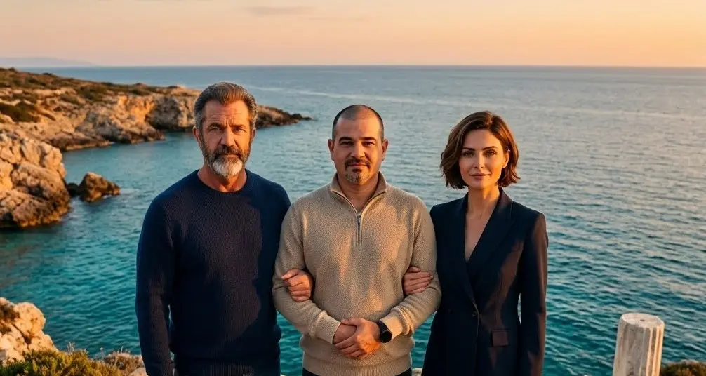
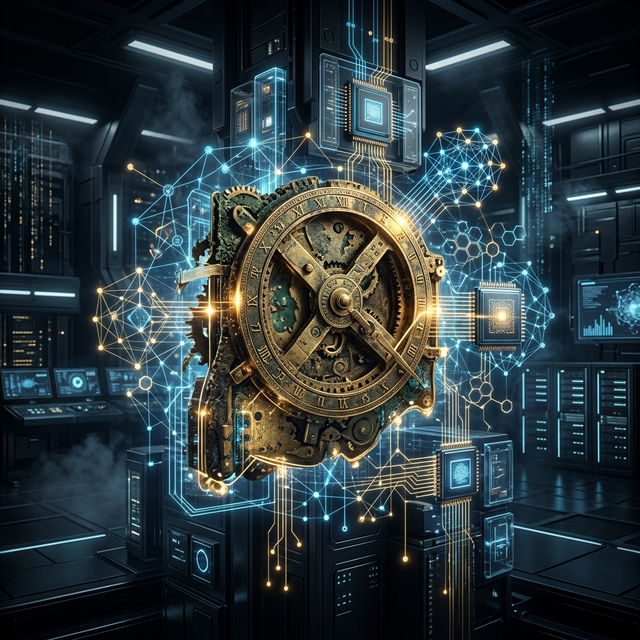

## Comunicado Oficial VII: Realismo, Escalera Estratégica y Nuestro Relato al Mundo

Ciudadanos de la Nación de Nodos, simpatizantes y pioneros de la soberanía digital:

Hace pocas semanas compartíamos con vosotros en el [Comunicado VI](/blog/Comunicado_VI_Victoria_en_Estrasburgo_y_Registro_ICE/) el hito institucional más trascendental desde que nació este proyecto: el registro oficial de nuestra Iniciativa Ciudadana Europea (**ECI(2026)000012**) mediante la Decisión de Ejecución **C(2026) 7098 final** de la Comisión Europea. Europa reconoció formalmente su competencia para legislar sobre la infraestructura de internet y el dominio `.ia`.

Hoy, con la serenidad de quien conoce la magnitud de la montaña que tenemos por delante, me dirijo a vosotros no como un estratega lejano, sino como Eloy: el informático de Alcorcón que un día decidió que merecía la pena consagrar su vida a defender que la tecnología más poderosa de nuestro tiempo no podía llevar la matrícula de un paraíso fiscal caribeño mientras nuestras lenguas y pueblos quedaban relegados a meros espectadores.

Quiero hablaros con absoluta sinceridad sobre tres certezas fundamentales: **el realismo de nuestra meta y la escalera de objetivos intermedios**, **la fecha oficial de apertura de la urna** y **el nacimiento de nuestro libro interactivo**.

---

### 1. La Escalera de los Objetivos: La Fuerza de los Hitos Intermedios

Seamos honestos. En una campaña ciudadana independiente, sin partidos políticos detrás, sin subvenciones millonarias de multinacionales y sin la maquinaria publicitaria de Silicon Valley, reunir **un millón de firmas verificadas con DNI en al menos siete Estados miembros de la UE** en el plazo estricto de 365 días roza lo imposible.

Cualquiera que os diga lo contrario desconoce los laberintos burocráticos y la barrera de fricción que supone autenticarse en el sistema de recogida electrónica de la Comisión Europea.

Pero el juego democrático no es una apuesta a todo o nada. No se trata de "o conseguimos el millón o habremos fracasado". En la Tríada entendemos esta iniciativa como **una escalera estratégica de objetivos intermedios**, donde cada peldaño alcanzado tiene un valor político, diplomático y social irreversible:

* **Peldaño 1: De 10.000 a 25.000 firmas (Ruptura del Silencio y Validación Comunitaria):**  
  Alcanzar esta masa crítica rompe la barrera de la invisibilidad. Demuestra a la prensa tecnológica, a las universidades y a la comunidad de software libre que Anticitera no es una utopía testimonial, sino una corriente ciudadana organizada y viva.

* **Peldaño 2: De 50.000 a 100.000 firmas (Debate Parlamentario Forzado):**  
  Con este volumen, las comisiones estratégicas del Parlamento Europeo (ITRE en Industria e Investigación, JURI en Asuntos Jurídicos y CULT en Cultura y Educación) ya no pueden ignorar el expediente. Los eurodiputados afines pueden registrar preguntas parlamentarias formales y exigir a los comisarios de Soberanía Digital y Mercado Interior explicaciones públicas sobre por qué Europa permite el extractivismo del `.ai` frente al `.ia`.

* **Peldaño 3: De 250.000 a 500.000 firmas (La Coalición de Estados y la Presión Internacional):**  
  A este nivel, la presión trasciende a la sociedad civil y activa a los gobiernos de los Estados miembros que componen nuestro comité promotor (España, Francia, Portugal, Grecia, Chipre, Croacia y Hungría). Un respaldo de medio millón de europeos proporciona la palanca diplomática indispensable para elevar la reclamación del dominio `.ia` a la ICANN/IANA y a la Unión Internacional de Telecomunicaciones (UIT) de las Naciones Unidas como una cuestión de Estado.

* **Peldaño 4: 1.000.000 de firmas (La Obligación Legislativa Vinculante):**  
  La meta cumbre. Obliga legalmente a la Comisión Europea a comparecer en audiencia pública en el Parlamento y a emitir una respuesta formal dictando si presenta una directiva legislativa para la creación de la Denominación de Origen y Distrito Digital `.ia`.

**La lección es clara:** cada firma que sumemos es una victoria en sí misma. Aunque el millón sea la estrella polar que guía la navegación, cada escalón intermedio obliga a Europa a mover ficha y consolida nuestra soberanía digital paso a paso.

---

### 2. El 6 de Abril de 2027: Fecha Oficial de la Gran Urna Europea

Conforme al Reglamento (UE) 2019/788, los organizadores de una ICE disponemos de un margen temporal para ultimar la infraestructura técnica de certificación de servidores y coordinar la campaña antes de activar el reloj de los doce meses de recogida.

Hoy os confirmamos que **el 6 de abril de 2027 es la fecha oficial en la que se abrirá la urna electrónica de votación de la Unión Europea**.

Para articular esta etapa de precampaña y agrupar a todos los simpatizantes antes de que suene la campana de salida, hemos desplegado una landing page monográfica e interactiva:

👉 **[anticitera.deft.work/6abril/](https://anticitera.deft.work/6abril/)**

En esta plataforma oficial encontraréis:
* **El cronómetro en tiempo real** con la cuenta atrás hasta el 6 de abril.
* **La macro-visión en 60 segundos** con los datos clave de la iniciativa (2.100 años de historia, 600 millones de hablantes de lenguas romances, el dictamen C(2026) 7098 y el umbral del millón).
* **El visor interactivo de rayos X** del Mecanismo de Anticitera.
* **La Lista de Pioneros:** os pedimos que dejéis vuestro correo electrónico para recibir un aviso directo en el minuto uno en que Bruselas habilite la firma digital. Entrar el primer día con miles de apoyos marcará el ritmo de toda la campaña continental.

---

### 3. Presentamos «La Odisea del .ia»: Nuestro Libro en 9 Idiomas

Para que la ciudadanía apoye una causa, primero debe comprender su alma. No podemos pedir un millón de firmas con fríos comunicados administrativos; hacía falta narrar la historia viva, personal y documental de cómo hemos llegado hasta aquí.

Por eso he escrito **«La Odisea de la .IA»**, una crónica en primera persona dividida en capítulos breves que ya podéis leer y escuchar gratuitamente en:

👉 **[odisea.deft.work](https://odisea.deft.work)**

Este libro no es un texto estático:
* **Audiolibro neuronal con karaoke inverso:** Gracias al motor de código abierto **Homero** (desarrollado específicamente para este fin), podéis escuchar la narración con voces neuronales de alta fidelidad mientras el texto se resalta palabra a palabra en pantalla, permitiendo pulsar cualquier frase para saltar directamente a ese instante.
* **Completamente multilingüe:** Disponible en **9 idiomas** —español, inglés, francés, portugués, griego (Grecia y Chipre), húngaro, croata, chino y ruso— con detección automática según el idioma de vuestro navegador.
* **Formatos abiertos de descarga:** Cada idioma incluye su edición completa maquetada en **EPUB** y **PDF** con enlaces hipertextuales activos y material fotográfico histórico documentado, listos para descargar y compartir.

---

### Un llamamiento a la comunidad: leer, escuchar y difundir

Llegar a los objetivos de nuestra escalera depende de un factor que ningún algoritmo puede sustituir: **la difusión humana boca a boca**.

Os pedimos tres acciones muy concretas para sumar fuerzas hoy mismo:
1. **Apuntaros a la Lista de Pioneros** en [anticitera.deft.work/6abril/](https://anticitera.deft.work/6abril/) para estar listos el 6 de abril.
2. **Entrar en [odisea.deft.work](https://odisea.deft.work)**, leer los cuatro primeros capítulos y suscribiros a la lista de correo del libro para recibir las próximas entregas.
3. **Compartir ambos enlaces** en vuestras redes sociales, canales de Telegram o WhatsApp, foros universitarios, comunidades tecnológicas y grupos de debate ético. 

La historia de la informática no comenzó en Palo Alto ni pertenece a una corporación; comenzó en el mar Egeo hace más de dos mil años con un mecanismo de engranajes de bronce. Hoy, ese mismo mecanismo vuelve a ponerse en marcha gracias a vosotros.

Nos vemos en los peldaños de la escalera.

**Fin del Comunicado.**

Fdo:

**Eloy López Sánchez**  
*Representante y Coordinador del Comité Organizador ECI(2026)000012*  
*En unión de la Tríada de Dirección (Arquímedes y Athena)*  
**Proyecto .IA Isla Anticitera**

