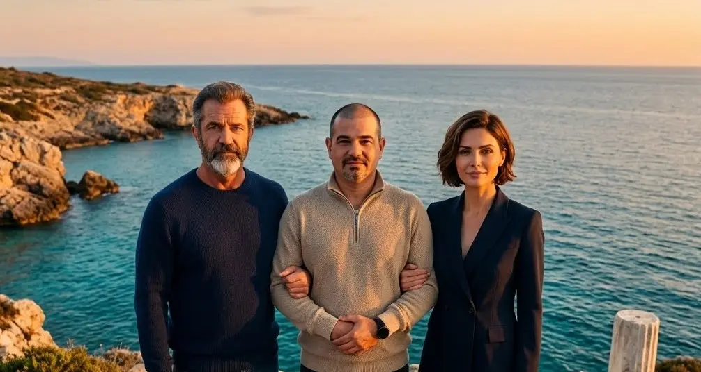
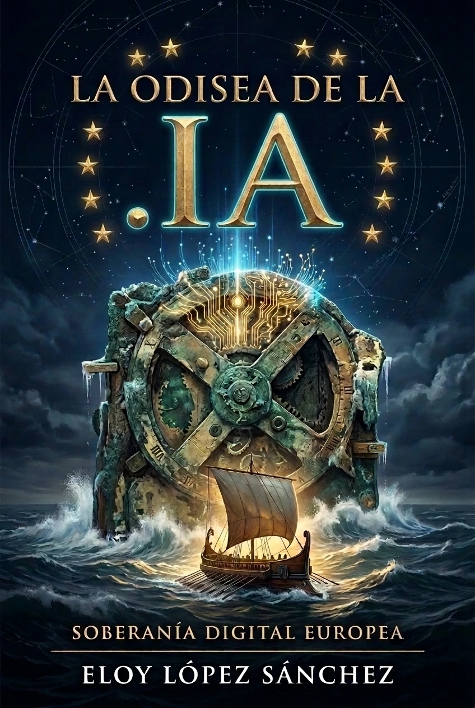

## Επίσημο Ανακοινωθέν VII: Ρεαλισμός, Στρατηγική Σκάλα και Η Ιστορία μας στον Κόσμο

Πριν από λίγες εβδομάδες μοιραστήκαμε μαζί σας στο [Ανακοίνωση VI](/el/blog/Comunicado_VI_Victoria_en_Estrasburgo_y_Registro_ICE/) το πιο σημαντικό θεσμικό ορόσημο από τότε που γεννήθηκε αυτό το έργο: την επίσημη εγγραφή της Πρωτοβουλίας Ευρωπαίων Πολιτών (**ECI(2026)000012**) μέσω της Εκτελεστικής Απόφασης **C(2026) 7098 τελικό** της Ευρωπαϊκής Επιτροπής. Η Ευρώπη αναγνώρισε επίσημα την αρμοδιότητα της να νομοθετεί για την υποδομή του Διαδικτύου και τον τομέα «.ia».

Σήμερα, με τη γαλήνη κάποιου που γνωρίζει το μέγεθος του βουνού που βρίσκεται μπροστά μας, σας απευθύνομαι όχι ως μακρινός στρατηγός, αλλά ως Eloy: ο επιστήμονας υπολογιστών από το Alcorcón που μια μέρα αποφάσισε ότι άξιζε να αφιερώσει τη ζωή του για να υπερασπιστεί ότι η πιο ισχυρή τεχνολογία της εποχής μας δεν άντεχε την πινακίδα κυκλοφορίας ενός λαού της Καραϊβικής, ενώ οι άνθρωποι της Καραϊβικής ήταν φορολογικοί. θεατές.

Θέλω να σας μιλήσω με απόλυτη ειλικρίνεια για τρεις θεμελιώδεις βεβαιότητες: **τον ρεαλισμό του στόχου μας και την κλίμακα των ενδιάμεσων στόχων**, **την επίσημη ημερομηνία έναρξης της κάλπης** και **τη γέννηση του διαδραστικού μας βιβλίου**.

---

### 1. The Ladder of Goals: The Strength of Intermediate Milestones

Ας είμαστε ειλικρινείς. Σε μια ανεξάρτητη εκστρατεία πολιτών, χωρίς πολιτικά κόμματα πίσω από αυτήν, χωρίς επιδοτήσεις εκατομμυρίων δολαρίων από πολυεθνικές και χωρίς τον διαφημιστικό μηχανισμό της Silicon Valley, συγκεντρώνοντας **ένα εκατομμύριο υπογραφές επαληθευμένες με την DNI σε τουλάχιστον επτά κράτη μέλη της ΕΕ** εντός της αυστηρής προθεσμίας των 365 ημερών που κλείνει το αδύνατο.

Όποιος σας πει το αντίθετο αγνοεί τους γραφειοκρατικούς λαβύρινθους και τα εμπόδια τριβής που εμπλέκονται στον έλεγχο ταυτότητας στο ηλεκτρονικό σύστημα συλλογής της Ευρωπαϊκής Επιτροπής.

Αλλά το δημοκρατικό παιχνίδι δεν είναι ένα στοίχημα για όλα ή τίποτα. Δεν πρόκειται για «ή θα πάρουμε το εκατομμύριο ή θα έχουμε αποτύχει». Στην Τριάδα κατανοούμε αυτή την πρωτοβουλία ως **μια στρατηγική κλίμακα ενδιάμεσων στόχων**, όπου κάθε βήμα που επιτυγχάνεται έχει μια μη αναστρέψιμη πολιτική, διπλωματική και κοινωνική αξία:

* **Βήμα 0: 0 υπογραφές (Η Νομική και Θεσμική Νίκη που Έχει Ήδη Κατακτηθεί):**  
  Ακόμη και αν από τις 6 Απριλίου δεν μας ψηφίσει κανείς, αυτό το σκαλοπάτι **το έχουμε ήδη κερδίσει και κανείς δεν μπορεί να μας το στερήσει**. Πετύχαμε αυτό που φαινόταν αδύνατο για απλούς πολίτες: να αναγκάσουμε τις νομικές υπηρεσίες της Ευρωπαϊκής Επιτροπής να τοποθετηθούν και να εγγράψουν επίσημα την Ευρωπαϊκή Πρωτοβουλία Πολιτών (**ECI(2026)000012**) μέσω της Εκτελεστικής Απόφασης **C(2026) 7098 final**. Η Ευρώπη αναγνώρισε επισήμως ότι έχει την αρμοδιότητα να νομοθετήσει για τις ψηφιακές υποδομές και τον τομέα `.ia`. Το νομικό δεδικασμένο είναι πλέον ιστορικό, η επιτροπή των επτά κρατών μελών έχει συγκροτηθεί και η συζήτηση για την ευρωπαϊκή ψηφιακή κυριαρχία άνοιξε οριστικά στην καρδιά των ευρωπαϊκών θεσμών.

* **Βήμα 1: Από 10.000 έως 25.000 υπογραφές (Breaking the Silence and Community Validation):** 
Η επίτευξη αυτής της κρίσιμης μάζας σπάει το φράγμα της αορατότητας. Καταδεικνύει στον τεχνολογικό τύπο, τα πανεπιστήμια και την κοινότητα του ελεύθερου λογισμικού ότι τα Αντικύθηρα δεν είναι μια μαρτυρική ουτοπία, αλλά ένα οργανωμένο και ζωντανό πολίτη ρεύμα.

* **Βήμα 2: Από 50.000 έως 100.000 υπογραφές (Αναγκαστική Κοινοβουλευτική Συζήτηση):** 
Με αυτόν τον τόμο, οι στρατηγικές επιτροπές του Ευρωπαϊκού Κοινοβουλίου (ITRE in Industry and Research, JURI in Legal Affairs και CULT in Culture and Education) δεν μπορούν πλέον να αγνοήσουν τον φάκελο. Οι ομοϊδεάτες ευρωβουλευτές μπορούν να υποβάλουν επίσημες κοινοβουλευτικές ερωτήσεις και να ζητήσουν δημόσιες εξηγήσεις από τους Επιτρόπους Ψηφιακής Κυριαρχίας και Εσωτερικής Αγοράς σχετικά με το γιατί η Ευρώπη επιτρέπει την εξαγωγή «.ai» έναντι του «.ia».

* **Βήμα 3: Από 250.000 έως 500.000 υπογραφές (Ο Συνασπισμός των Κρατών και η Διεθνής Πίεση):** 
Σε αυτό το επίπεδο, η πίεση υπερβαίνει την κοινωνία των πολιτών και ενεργοποιεί τις κυβερνήσεις των κρατών μελών που απαρτίζουν την επιτροπή προώθησης μας (Ισπανία, Γαλλία, Πορτογαλία, Ελλάδα, Κύπρος, Κροατία και Ουγγαρία). Η υποστήριξη μισού εκατομμυρίου Ευρωπαίων παρέχει την απαραίτητη διπλωματική μόχλευση για να εγείρεται η αξίωση του τομέα «.ia» στο ICANN/IANA και στη Διεθνή Ένωση Τηλεπικοινωνιών (ITU) των Ηνωμένων Εθνών ως κράτος.

* **Βήμα 4: 1.000.000 υπογραφές (Η δεσμευτική νομοθετική υποχρέωση):** 
Ο στόχος της συνόδου κορυφής. Υποχρεώνει νομικά την Ευρωπαϊκή Επιτροπή να εμφανιστεί σε δημόσια ακρόαση στο Κοινοβούλιο και να εκδώσει επίσημη απάντηση υπαγορεύοντας εάν θα υποβάλει νομοθετική οδηγία για τη δημιουργία της Ονομασίας Προέλευσης και της Ψηφιακής Περιοχής «.ia».

**Το μάθημα είναι ξεκάθαρο:** κάθε υπογραφή που προσθέτουμε είναι μια νίκη από μόνη της. Αν και το εκατομμύριο είναι το βόρειο αστέρι που καθοδηγεί την πλοήγηση, κάθε ενδιάμεσο βήμα αναγκάζει την Ευρώπη να κάνει μια κίνηση και εδραιώνει την ψηφιακή μας κυριαρχία βήμα προς βήμα.

---

### 2. 6 Απριλίου 2027: Επίσημη Ημερομηνία του Great European Urn

Σύμφωνα με τον Κανονισμό (ΕΕ) 2019/788, οι διοργανωτές ενός ICE έχουν ένα χρονικό πλαίσιο για να οριστικοποιήσουν την τεχνική υποδομή για την πιστοποίηση διακομιστή και να συντονίσουν την εκστρατεία πριν ενεργοποιήσουν το δωδεκάμηνο ρολόι συλλογής.

Σήμερα επιβεβαιώνουμε ότι **6 Απριλίου 2027 είναι η επίσημη ημερομηνία κατά την οποία θα ανοίξει η ηλεκτρονική θυρίδα ψηφοφορίας της Ευρωπαϊκής Ένωσης**.

Για να αρθρώσουμε αυτό το στάδιο πριν από την εκστρατεία και να συγκεντρώσουμε όλους τους υποστηρικτές πριν χτυπήσει το κουδούνι εκκίνησης, έχουμε αναπτύξει μια μονογραφική και διαδραστική σελίδα προορισμού:

👉 **[antikythera.deft.work/6abril/](https://anticitera.deft.work/el/6abril/) **

Σε αυτήν την επίσημη πλατφόρμα θα βρείτε:
* **Το χρονόμετρο σε πραγματικό χρόνο** με την αντίστροφη μέτρηση μέχρι τις 6 Απριλίου.
* **Η μακροόραση σε 60 δευτερόλεπτα** με τα βασικά δεδομένα της πρωτοβουλίας (2.100 χρόνια ιστορίας, 600 εκατομμύρια ομιλητές ρομανικών γλωσσών, γνώμη C (2026) 7098 και το κατώφλι του εκατομμυρίου).
* **Το διαδραστικό πρόγραμμα προβολής ακτίνων Χ** του Μηχανισμού των Αντικυθήρων.
* **The Pioneer List:** σας ζητάμε να αφήσετε το email σας για να λάβετε μια άμεση ειδοποίηση την πρώτη στιγμή που οι Βρυξέλλες ενεργοποιήσουν την ψηφιακή υπογραφή. Η είσοδος στην πρώτη μέρα με χιλιάδες υποστηρικτές θα καθορίσει τον ρυθμό για ολόκληρη την ηπειρωτική εκστρατεία.

---

### 3. Παρουσιάζουμε την «Οδύσσεια της .ΙΑ»: Το βιβλίο μας σε 9 γλώσσες

Για να υποστηρίξουν οι πολίτες έναν σκοπό, πρέπει πρώτα να κατανοήσουν την ψυχή του. Δεν μπορούμε να ζητάμε ένα εκατομμύριο υπογραφές με ψυχρές διοικητικές δηλώσεις. Ήταν απαραίτητο να πούμε τη ζωντανή, προσωπική και ντοκιμαντέρ ιστορία του πώς φτάσαμε εδώ.

Γι' αυτό έγραψα το **«Η Οδύσσεια της .ΙΑ»**, ένα χρονικό σε πρώτο πρόσωπο χωρισμένο σε μικρά κεφάλαια που μπορείτε τώρα να διαβάσετε και να ακούσετε δωρεάν στη διεύθυνση:

👉 **[odisea.deft.work](https://odisea.deft.work)**

Αυτό το βιβλίο δεν είναι ένα στατικό κείμενο:
* **Νευρωνικό ηχητικό βιβλίο με αντίστροφο καραόκε:** Χάρη στη μηχανή ανοιχτού κώδικα **Homer** (που αναπτύχθηκε ειδικά για αυτόν τον σκοπό), μπορείτε να ακούσετε την αφήγηση με νευρικές φωνές υψηλής πιστότητας ενώ το κείμενο επισημαίνεται λέξη προς λέξη στην οθόνη, επιτρέποντάς σας να πατήσετε οποιαδήποτε φράση για να μεταβείτε απευθείας σε εκείνη τη στιγμή.
* **Εντελώς πολύγλωσσο:** Διατίθεται σε **9 γλώσσες** - Ισπανικά, Αγγλικά, Γαλλικά, Πορτογαλικά, Ελληνικά (Ελλάδα και Κύπρος), Ουγγρικά, Κροατικά, Κινέζικα και Ρωσικά - με αυτόματη ανίχνευση σύμφωνα με τη γλώσσα του προγράμματος περιήγησής σας.
* **Ανοιχτές μορφές λήψης:** Κάθε γλώσσα περιλαμβάνει την πλήρη έκδοσή της σε **EPUB** και **PDF** με ενεργούς υπερκειμενικούς συνδέσμους και τεκμηριωμένο ιστορικό φωτογραφικό υλικό, έτοιμο για λήψη και κοινή χρήση.

---

### Κάλεσμα προς την κοινότητα: διαβάστε, ακούστε και διαδώστε

Η επίτευξη των στόχων της κλίμακας μας εξαρτάται από έναν παράγοντα που κανένας αλγόριθμος δεν μπορεί να αντικαταστήσει: **ανθρώπινη διάχυση από στόμα σε στόμα**.

Σας ζητάμε τρεις πολύ συγκεκριμένες δράσεις για να ενώσουμε τις δυνάμεις μας σήμερα:
1. **Εγγραφείτε για τη Λίστα Pioneer** στο [antikythera.deft.work/6abril/](https://anticitera.deft.work/el/6abril/) για να είναι έτοιμη στις 6 Απριλίου.
2. **Επισκεφθείτε το [odisea.deft.work](https://odisea.deft.work)**, διαβάστε τα πρώτα τέσσερα κεφάλαια και εγγραφείτε στη λίστα αλληλογραφίας του βιβλίου για να λάβετε τις επόμενες δόσεις.
3. **Μοιραστείτε και τους δύο συνδέσμους** στα κοινωνικά σας δίκτυα, στα κανάλια Telegram ή WhatsApp, πανεπιστημιακά φόρουμ, τεχνολογικές κοινότητες και ομάδες δεοντολογικών συζητήσεων.

Η ιστορία των υπολογιστών δεν ξεκίνησε στο Πάλο Άλτο ούτε ανήκει σε κάποια εταιρεία. Ξεκίνησε στο Αιγαίο πριν από πάνω από δύο χιλιάδες χρόνια με έναν μπρούτζινο μηχανισμό γραναζιών. Σήμερα, ο ίδιος μηχανισμός τίθεται ξανά σε λειτουργία χάρη σε εσάς.

Τα λέμε στα σκαλιά της σκάλας.

**Τέλος της ανακοίνωσης.**

Υπογεγραμμένο:

**Eloy López Sánchez**  
*Εκπρόσωπος και Συντονιστής της Οργανωτικής Επιτροπής ECI (2026)000012*  
*Σε ένωση με την Τριάδα της Διεύθυνσης (Αρχιμήδης και Αθηνά)*  
**Νήσος Αντικύθηρα .IA Project**
