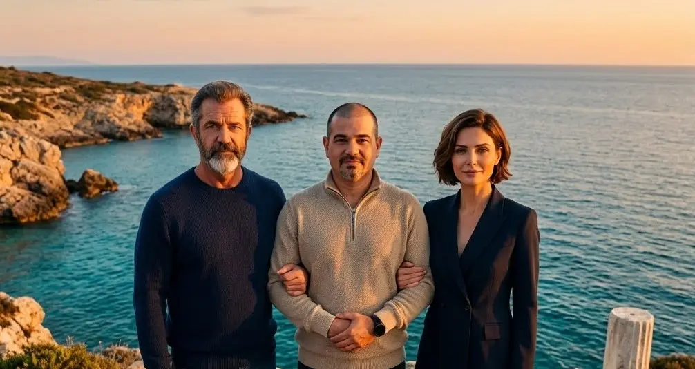
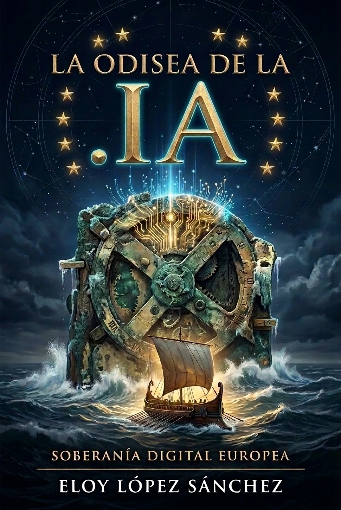

## Official Communiqué VII: Realism, Strategic Ladder and Our Story to the World

Citizens of the Nation of Nodes, supporters and pioneers of digital sovereignty:

A few weeks ago we shared with you on [Communiqué VI](/en/blog/Comunicado_VI_Victoria_en_Estrasburgo_y_Registro_ICE/) the most important institutional milestone since this project was born: the official registration of our European Citizens' Initiative (**ECI(2026)000012**) through the Implementing Decision **C(2026) 7098 final** of the European Commission. Europe formally recognized its competence to legislate on internet infrastructure and the `.ia` domain.

Today, with the serenity of someone who knows the magnitude of the mountain that lies ahead of us, I address you not as a distant strategist, but as Eloy: the computer scientist from Alcorcón who one day decided that it was worth dedicating his life to defending that the most powerful technology of our time could not bear the license plate of a Caribbean tax haven while our languages ​​and peoples were relegated to mere spectators.

I want to speak to you with absolute sincerity about three fundamental certainties: **the realism of our goal and the ladder of intermediate objectives**, **the official opening date of the ballot box** and **the birth of our interactive book**.

---

### 1. The Ladder of Goals: The Strength of Intermediate Milestones

Let's be honest. In an independent citizen campaign, without political parties behind it, without million-dollar subsidies from multinationals and without the advertising machinery of Silicon Valley, gathering **one million signatures verified with DNI in at least seven EU Member States** within the strict deadline of 365 days borders on the impossible.

Anyone who tells you otherwise is unaware of the bureaucratic labyrinths and friction barrier involved in authenticating yourself in the European Commission's electronic collection system.

But the democratic game is not an all or nothing bet. It's not about "either we get the million or we will have failed." At the Triad we understand this initiative as **a strategic ladder of intermediate objectives**, where each step reached has an irreversible political, diplomatic and social value:

* **Step 0: 0 signatures (The Legal and Institutional Victory Already Achieved):**  
  Even if absolutely no one votes for us starting on April 6, this milestone **is already won and no one can take it away from us**. We have achieved what seemed impossible for ordinary citizens: compelling the European Commission's legal services to rule on the matter and formally register our European Citizens' Initiative (**ECI(2026)000012**) under Implementing Decision **C(2026) 7098 final**. Europe has officially recognized its legal competence to regulate digital naming infrastructure and the `.ia` domain. The legal precedent is permanently established in the Official Journal, the seven-nation committee is formed, and the debate over European digital sovereignty is irreversibly open in Brussels.

* **Step 1: From 10,000 to 25,000 signatures (Breaking the Silence and Community Validation):** 
Reaching this critical mass breaks the barrier of invisibility. It demonstrates to the technology press, universities and the free software community that Antikythera is not a testimonial utopia, but rather an organized and living citizen current.

* **Step 2: From 50,000 to 100,000 signatures (Forced Parliamentary Debate):** 
With this volume, the strategic committees of the European Parliament (ITRE in Industry and Research, JURI in Legal Affairs and CULT in Culture and Education) can no longer ignore the file. Like-minded MEPs can register formal parliamentary questions and demand public explanations from Digital Sovereignty and Internal Market Commissioners on why Europe allows `.ai` versus `.ia` extractivism.

* **Step 3: From 250,000 to 500,000 signatures (The Coalition of States and International Pressure):** 
At this level, the pressure transcends civil society and activates the governments of the member states that make up our promoting committee (Spain, France, Portugal, Greece, Cyprus, Croatia and Hungary). A support of half a million Europeans provides the indispensable diplomatic leverage to raise the claim of the `.ia` domain to ICANN/IANA and the International Telecommunication Union (ITU) of the United Nations as a matter of State.

* **Step 4: 1,000,000 signatures (The Binding Legislative Obligation):** 
The summit goal. It legally obliges the European Commission to appear at a public hearing in Parliament and to issue a formal response dictating whether to present a legislative directive for the creation of the Denomination of Origin and Digital District `.ia`.

**The lesson is clear:** each signature we add is a victory in itself. Although the million is the north star that guides navigation, each intermediate step forces Europe to make a move and consolidates our digital sovereignty step by step.

---

### 2. April 6, 2027: Official Date of the Great European Urn

In accordance with Regulation (EU) 2019/788, the organizers of an ICE have a time frame to finalize the technical infrastructure for server certification and coordinate the campaign before activating the twelve-month collection clock.

Today we confirm that **April 6, 2027 is the official date on which the European Union's electronic voting box will be opened**.

To articulate this pre-campaign stage and bring together all the supporters before the starting bell rings, we have deployed a monographic and interactive landing page:

👉 **[antikythera.deft.work/6abril/](https://anticitera.deft.work/en/6abril/) **

On this official platform you will find:
* **The real-time stopwatch** with the countdown until April 6.
* **The macro-vision in 60 seconds** with the key data of the initiative (2,100 years of history, 600 million speakers of Romance languages, opinion C (2026) 7098 and the million threshold).
* **The interactive X-ray viewer** of the Antikythera Mechanism.
* **The Pioneer List:** we ask you to leave your email to receive a direct notification the first minute Brussels enables the digital signature. Entering the first day with thousands of supporters will set the pace for the entire continental campaign.

---

### 3. We present “The .IA Odyssey”: Our Book in 9 Languages

For citizens to support a cause, they must first understand its soul. We cannot ask for a million signatures with cold administrative statements; It was necessary to tell the living, personal and documentary story of how we got here.

That is why I have written **«The .IA Odyssey»**, a first-person chronicle divided into short chapters that you can now read and listen to for free at:

👉 **[odisea.deft.work](https://odisea.deft.work)**

This book is not a static text:
* **Neural audiobook with reverse karaoke:** Thanks to the **Homer** open source engine (developed specifically for this purpose), you can listen to the narration with high-fidelity neural voices while the text is highlighted word by word on the screen, allowing you to press any phrase to jump directly to that moment.
* **Completely multilingual:** Available in **9 languages** - Spanish, English, French, Portuguese, Greek (Greece and Cyprus), Hungarian, Croatian, Chinese and Russian - with automatic detection according to the language of your browser.
* **Open download formats:** Each language includes its complete edition laid out in **EPUB** and **PDF** with active hypertextual links and documented historical photographic material, ready to download and share.

---

### A call to the community: read, listen and spread

Reaching the objectives of our ladder depends on a factor that no algorithm can replace: **human word-of-mouth diffusion**.

We ask you for three very specific actions to join forces today:
1. **Sign up for the Pioneer List** in [antikythera.deft.work/6abril/](https://anticitera.deft.work/en/6abril/) to be ready on April 6.
2. **Go to [odisea.deft.work](https://odisea.deft.work)**, read the first four chapters and subscribe to the book's mailing list to receive the next installments.
3. **Share both links** on your social networks, Telegram or WhatsApp channels, university forums, technological communities and ethical debate groups.

The history of computing did not begin in Palo Alto nor does it belong to a corporation; It began in the Aegean Sea over two thousand years ago with a bronze gear mechanism. Today, that same mechanism is put into action again thanks to you.

See you on the steps of the ladder.

**End of Communiqué.**

Signed:

**Eloy López Sánchez**  
*Representative and Coordinator of the ECI Organizing Committee (2026)000012*  
*In union with the Direction Triad (Archimedes and Athena)*  
**Antikythera Island .IA Project**
